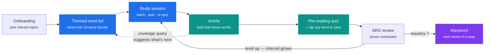
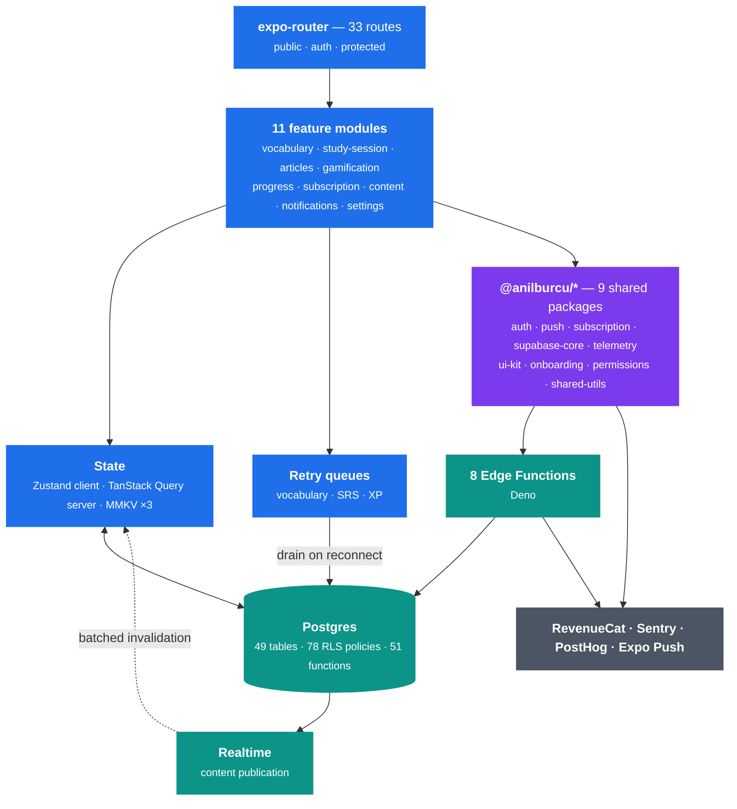
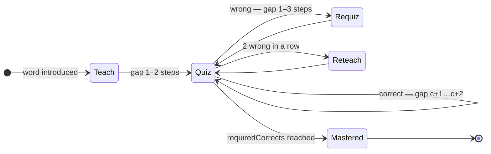
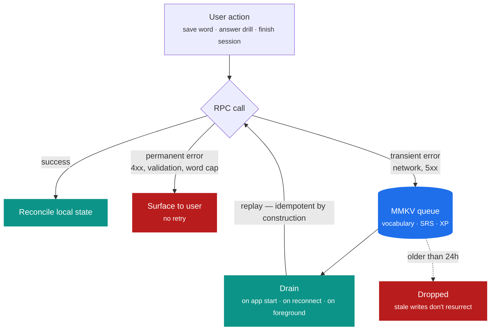
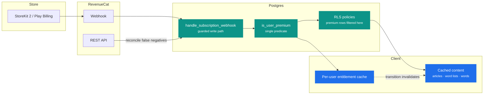

<div align="center">

# Radora

**Learn English by reading. A production React Native app built on a shared monorepo foundation.**

Vocabulary that teaches itself through articles you actually want to read — one scheduling engine on the client, one source of truth on the server.

[](https://reactnative.dev/)
[](https://expo.dev/)
[](https://www.typescriptlang.org/)
[](https://supabase.com/)
[](https://www.revenuecat.com/)
[](#)
[](#)
[](#)

`EN` · `ES` · `TR` &nbsp;·&nbsp; [Contact](#contact)

</div>

---

## Overview

Radora teaches English through reading. Instead of drilling word lists in isolation, it closes a loop: you pick topics you care about, learn a themed set of words, read an article built from those exact words, then reinforce whatever didn't stick. Every screen in the app is a station on that loop.

The app is the first tenant of a React Native monorepo. Nine `@anilburcu/*` packages own the concerns that repeat across products — auth, push, subscriptions, telemetry, permissions, onboarding, UI primitives — while the app repo owns only what makes Radora *Radora*: the study engine, the vocabulary model, the content pipeline, and the schema behind them.

This README is a walk through the engineering, not a feature list.

## At a Glance

|                    |                                                                                     |
| ------------------ | ----------------------------------------------------------------------------------- |
| **Platforms**      | iOS and Android — one TypeScript codebase, Hermes, New Architecture                 |
| **App code**       | ~44K lines TypeScript across 11 feature modules, 28 routes                          |
| **Database**       | 49 tables, RLS on every one of them, 78 policies, 51 Postgres functions             |
| **Migrations**     | 32 sequential migrations, applied test-first before production                      |
| **Serverless**     | 8 Deno Edge Functions — subscriptions, push delivery, account deletion              |
| **Shared packages**| 9 workspace packages, each independently consumable                                 |
| **Offline**        | 3 idempotent MMKV retry queues, React Query persisted to disk with a build-keyed bust |
| **Localization**   | English, Spanish, Turkish — 10 namespaces, content translated at the row level      |
| **Monetization**   | RevenueCat on StoreKit 2, entitlement decided by a single server predicate          |

## The Loop

The product thesis in one diagram. Everything the app does exists to move a word from *unseen* to *mastered*, and the article layer is what makes that feel like reading rather than drilling.



Word lists and articles are linked at the **word level**, not by tag. Four `SECURITY DEFINER` recommendation RPCs run coverage queries — *which article uses the most words you already know?* — and return only IDs and counters, never sentence text, so the same engine can recommend a premium article to a free user as a locked card without leaking its content.

## Architecture



### Monorepo boundaries

The app and the monorepo are separate git repositories — the app lives at `apps/radora` inside the workspace, with its own history. Installs always run from the workspace root; a `preinstall` guard fails loudly if someone tries to install from the app directory, because `@anilburcu/*` is unpublished and resolves only through workspaces.

The packages hold one hard rule: **no package depends on another package's tables.** `push` doesn't know about `auth`; `subscription` doesn't know about `push`. They all reference `auth.users` and nothing else. That constraint is what makes the second app cheap — pull in `auth` and `subscription`, skip the rest, no untangling.

| Package | Owns |
| --- | --- |
| `auth` | Apple / Google / email OTP, session store, rate limiting |
| `push` | Token registration, channels, inbox, receipt verification |
| `subscription` | RevenueCat lifecycle, entitlement cache, conflict recovery |
| `supabase-core` | Client factory, MMKV instances, Zustand storage adapter, polyfills |
| `telemetry` | Sentry + PostHog wiring, error boundary, release tagging |
| `ui-kit` | Shared components, theme primitives |
| `onboarding` | Step framework and screens |
| `permissions` | Permission prompts and state |
| `shared-utils` | Retry, timeout, in-flight guards, logging |

## The Study Session Engine

The most interesting code in the app is a pure reducer with no imports.

**The problem.** The first engine was a round machine: teach a batch, quiz the batch in the same order, replay the misses as a block at the end. It worked, and it was boring — after two rounds the learner knew exactly what was coming, and prediction is the enemy of recall.

**The rewrite.** Rounds are gone. There is one queue of scheduled steps, and answering a question re-inserts that word at a *variable distance* ahead:



The rules that make it feel human rather than mechanical:

- **One step per word, always.** Every introduced-but-unmastered word owns exactly one step — either on screen or somewhere in the queue. No duplicates, no orphans.
- **Expanding rehearsal.** The more times you've got a word right, the further out its next appearance lands. When the active set is small the gap clamps to the end of the queue, which produces the "asked me second-to-last" effect that makes the end of a session feel earned.
- **A slip isn't a reset.** Wrong answers don't zero the correct-count. Two consecutive misses schedule a real re-teach card; a single miss reuses the feedback card as the reminder.
- **New words are drip-fed.** The session opens with two teach cards, then introduces a new word only when an existing one survives its first quiz or masters out. A struggling learner stops receiving new material automatically.
- **Deterministic jitter.** All randomness comes from a seeded PRNG whose state lives inside the session object, so the reducer stays pure. Tests pass a fixed seed and assert exact sequences; production picks a random one.

The engine never touches the network. The UI observes transitions and fires the side effects — which is what makes the whole thing unit-testable without a single mock.

## Spaced Repetition — Server Authoritative

Session mastery is short-term. Long-term retention runs on a seven-step ladder, where the mastery level *is* the interval:

| Mastery | 1 | 2 | 3 | 4 | 5 | 6 | 7 |
| --- | --- | --- | --- | --- | --- | --- | --- |
| **Next review in** | 1 day | 3 days | 7 days | 30 days | 90 days | 180 days | 365 days |

The whole decision lives in one `SECURITY DEFINER` Postgres function. `record_word_review(word_id, is_correct)` returns the new mastery level, the next review date, and whether the word leveled up; the client reconciles against that answer instead of predicting it. Three properties fall out of putting it there:

- **You can't farm a word.** A correct answer only levels a word up if its review is actually *due*. Answering the same word ten times in one sitting advances it exactly once — and since a level-up pushes the next review into the future, the second attempt is by definition not due. The cap is a consequence of the schedule, not a counter that needs its own enforcement.
- **You can't tank a word either.** A wrong answer drops the level by one and resets the interval to a day, but only the *first* miss each day is penalised. `last_incorrect_at` absorbs the rest, so fumbling a word repeatedly in one session costs you one level, not five.
- **Concurrent writes serialize.** Review, add-to-vocabulary, and remove-from-vocabulary all take the same per-`(user, word)` advisory lock, so a drained retry queue racing a live session can't interleave into a torn progress row.

Timezone matters here and is handled explicitly: "today" is computed from the user's stored timezone preference, not the server's clock, so a review due date doesn't roll over at the wrong hour for anyone.

## Writes That Survive a Bad Network

Three MMKV-backed queues catch failed writes and drain them on app start, on reconnect, and on foreground.



Replay is only safe because every queued RPC is idempotent by construction:

- **Vocabulary** — `add_word_to_vocabulary` reactivates a soft-deleted row; `remove_word_from_vocabulary` is a no-op on an already-removed one. Replaying a partially-succeeded call changes nothing.
- **XP** — `xp_transactions` carries a partial unique index on `(user_id, source_type, source_id)`. A replayed award hits the conflict and returns `already_awarded: true` without touching `user_stats`.
- **SRS** — reviews carry the owning `user_id`. The server RPC uses `auth.uid()`, so a queue drained under a *different* session would write one user's reviews to another account. The drainer processes only the active user's items and leaves the rest for their owner.

Errors are classified before they ever reach a queue. A word-limit rejection or a validation failure is permanent — queueing it would retry a guaranteed failure every time the network flickers.

## Realtime Content Sync

Content is authored through a script pipeline, not a CMS. When a batch import runs, connected clients need the new articles without a pull-to-refresh — so the protected layout opens one Realtime channel across the content tables and invalidates the matching React Query namespaces.

The naive version of this was a genuine outage vector. A single article import produces hundreds of row inserts, and invalidating on every event refetched every active articles query — multi-megabyte detail payloads included — hundreds of times, on every connected device at once. A textbook thundering herd, self-inflicted.

Events now collect into a 5-second batch window: every event inside the window collapses into one invalidation set. Three namespaces are tracked rather than one, because their cache keys interlock — `word_lists` carries the member ID set that `words.byIds` is keyed on, so a membership change that didn't bump the words namespace would keep serving stale detail payloads for the new IDs.

Realtime is a UX improvement, not a correctness requirement. If the publication is disabled, queries still refresh on stale-time expiry and pull-to-refresh.

## Premium — One Predicate, Enforced in the Database



Premium content is filtered by **Row Level Security**, not by a client-side `if`. A free user's query for a premium article returns the shell row and no sentences — the enforcement is in the same place as the data.

Two consequences worth calling out:

**Entitlement transitions invalidate cached content.** RLS returns a *different row set* for the same query depending on premium status, but query keys have no premium dimension and articles are persisted to MMKV. The moment entitlement flips, that cache — including the empty shell article prefetched while free — is stale. A bridge watches the package's subscription store and invalidates the articles, word-lists, and words namespaces on every transition, so a purchase never lands the user on a "no content" screen.

**Quota exhaustion clamps XP; it never blocks learning.** The daily drill quota is enforced server-side, counted in *words* rather than transactions — the original implementation counted `xp_transactions` rows, so a 20-word session incremented `used` by one and the intended "20 words/day" was really "~200 words/day". When the quota runs out, the award functions clamp XP to whatever remains and return `quota_exhausted` / `quota_clamped`. Reviews and SRS writes are never rejected. You can always keep studying; you just stop earning.

Quota reads run under a per-user advisory lock, so two sessions finishing simultaneously can't spend the same remaining quota twice.

## Data Layer

```
supabase/
├── migrations/            32 sequential SQL migrations
│   ├── 021_security_advisor_hardening.sql
│   ├── 022_authz_guard_user_id_rpcs.sql
│   ├── 025_content_premium_gating.sql
│   ├── 028_topic_loop.sql
│   ├── 031_drill_quota_server_enforcement.sql
│   ├── 032_auth_audit_hardening.sql
│   └── …
├── schema/                Generated dump — 49 tables, 78 policies, 51 functions
├── functions/             8 Deno Edge Functions
│   ├── claim-subscription        Server-verified entitlement transfer
│   ├── preflight-subscription    Conflict detection before billing fires
│   ├── sync-subscription         RC-REST reconciliation (false negatives only)
│   ├── verify-subscription       Entitlement check
│   ├── revenuecat-webhook        Subscription event ingestion
│   ├── push-notifications        Server-side push delivery
│   ├── check-push-receipts       Delivery receipt verification
│   └── delete-account            GDPR account + data removal
└── __integration_tests__/ Suite that runs serially against a real test schema
```

Migrations are applied test-database first and promoted to production only after verification. Types are generated from the live schema into the repo, so a column rename fails at compile time instead of at runtime.

The integration suite covers the things unit tests structurally cannot: realtime publication membership, chunked fetch behaviour, the premium predicate's parity between the webhook path and `verify-subscription`, RLS gating from an actual authenticated session, the 50-word saved cap, and subscription reconciliation.

## Project Structure

```
apps/radora/
├── app/                         expo-router — 33 routes
│   ├── (public)/                Welcome
│   ├── (auth)/                  Login, OTP verification
│   └── (protected)/
│       ├── (onboarding)/        Interest + language setup
│       ├── (tabs)/              home · read · study · profile
│       ├── article/[id]         Reader
│       ├── word/[id]            Word detail
│       ├── study-session        Drill runner
│       ├── word-chunk           10-word set
│       ├── premium-modal        Paywall
│       └── …
│
├── src/
│   ├── features/                Domain modules
│   │   ├── vocabulary/          Word model, SRS, chunking, action queue
│   │   │   ├── srs/             Scheduling service + retry queue
│   │   │   └── chunks/          List slicing, chunk prioritisation
│   │   ├── study-session/       Pure session engine + components
│   │   │   └── engine/          Interleaved gap scheduler
│   │   ├── articles/            Reader, pre-reading quiz, reactions
│   │   ├── gamification/        XP economy, levels, streaks, award queue
│   │   ├── progress/            Sync, topic mastery, weekly XP
│   │   ├── subscription/        Premium bridge, gating hooks
│   │   ├── content/             Content cache slice
│   │   ├── notifications/       Inbox and preferences
│   │   ├── onboarding/          Steps
│   │   ├── home/                Dashboard
│   │   └── settings/            Preferences, account
│   │
│   ├── lib/                     Core wiring
│   │   ├── bootstrap.ts         Synchronous MMKV init — must load first
│   │   ├── queryClient.ts       Query keys and defaults
│   │   ├── queryPersister.ts    MMKV persistence, build-keyed cache bust
│   │   ├── realtime/            Content sync channel
│   │   ├── supabase/            Client, helpers, generated types
│   │   └── telemetry-setup.ts   Sentry + PostHog
│   │
│   └── shared/                  Components, store slices, localization, types
│
├── supabase/                    Migrations, schema, Edge Functions, integration tests
├── articles/                    Authored content source
└── scripts/                     50+ content pipeline and ops scripts
```

### Boot order is load-bearing

`bootstrap.ts` runs at module load, before anything else touches storage. Zustand's `persist` middleware reads synchronously the moment a store is *created* — which happens at import time — so if MMKV instances aren't initialised first, the app crashes on `getString` of `undefined`. The import order in the root layout is a documented contract, not a style preference.

## Content Pipeline

Articles aren't hand-entered. A set of TypeScript and Python scripts builds them: word-alignment analysis links every article to the vocabulary it uses, multi-sense words get contextual disambiguation, translations are validated across all three languages, images are versioned and uploaded, and a preflight check runs before anything reaches the database. Turkish translations alone went through four review passes as their own migrations, including a loanword cleanup.

## Quality

- **Testing** — unit tests over the session engine, SRS, chunking, and store logic, plus a serial integration suite against a real Supabase schema.
- **Type safety** — TypeScript strict mode; database types generated from the live schema and committed.
- **Gate** — `npm run verify` runs lint, tests, and `expo-doctor` in one command.
- **Release** — EAS Build with local production builds; `expo-updates` on an `appVersion` runtime policy, so OTA updates never cross a native boundary.
- **Cache correctness** — the React Query persister is keyed on the native build version, so a binary upgrade can never read a payload shaped by an older fetch. User-specific queries are excluded from persistence entirely.

## Engineering Decisions Worth Calling Out

- **Identity is not branding.** The app displays "Radora", but the slug, bundle identifier, scheme, EAS project ID, and the RevenueCat and Sentry project strings all stay `language-traveler`. Renaming any of them would spin up a new store listing, break premium detection for existing subscribers, and orphan crash reports. The rename stops at the surface, deliberately, and the config file says so.
- **The server decides, the client reconciles.** SRS scheduling, XP awards, quota accounting, and premium status are all computed in Postgres. The client sends intent and applies the answer.
- **Derive, don't denormalize.** Chunk progress, topic mastery, and weekly XP are computed from data already in the cache. No extra queries, no server-side counters to drift out of sync.
- **Idempotency is a prerequisite for retry.** Every queued write was designed to be replay-safe before the queue was written, not after a bug proved it wasn't.
- **Failure modes are chosen, not discovered.** Quota exhaustion clamps rather than blocks. Realtime degrades to stale-time. Stale queue items expire. Each of these is a decision recorded in the code.

## Contact

This is a showcase repository — the source is private.

For collaboration, employment, or technical questions: [anl@icodex.dev](mailto:anl@icodex.dev) · [icodex.dev](https://icodex.dev) · [LinkedIn](https://www.linkedin.com/in/anil-burcu/)
